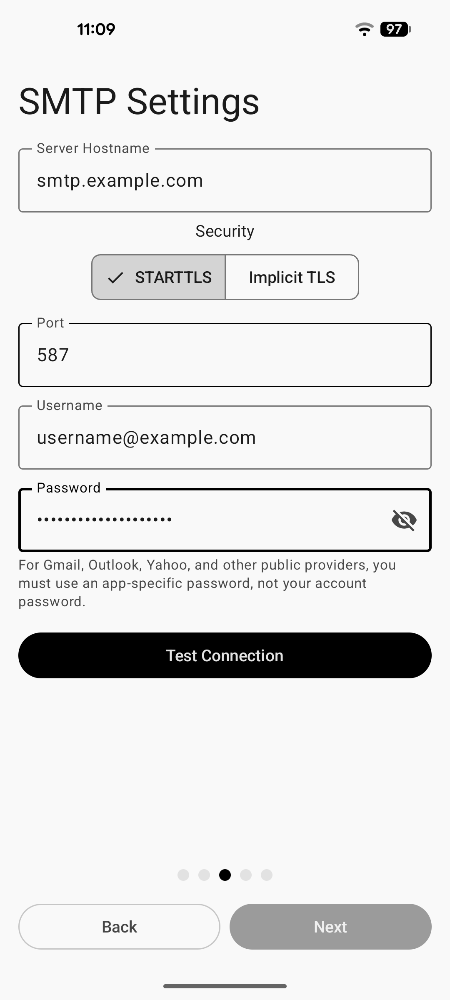
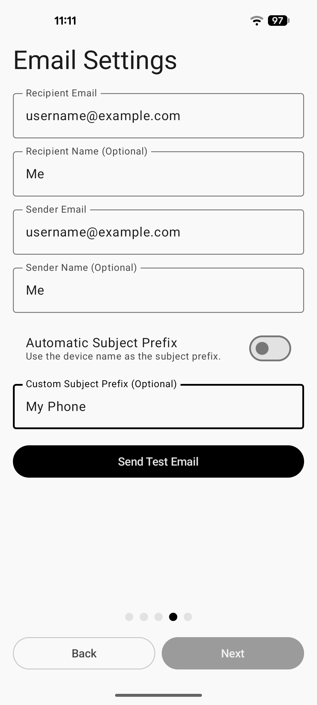
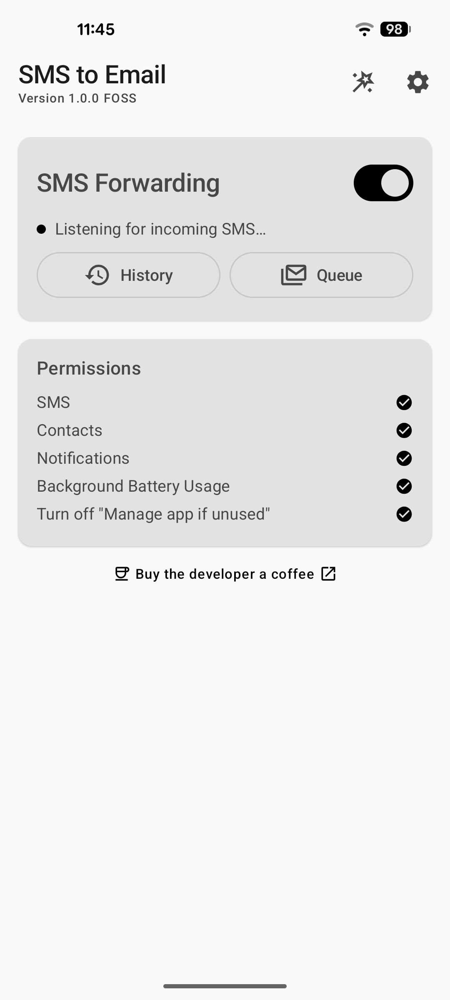
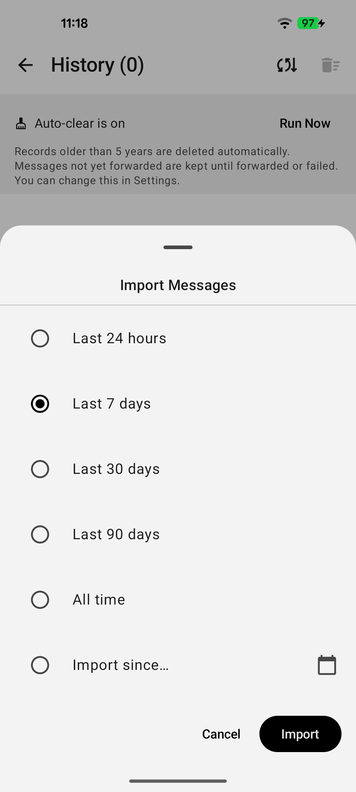

# SMS to Email

SMS to Email forwards incoming SMS messages to your own email address via a custom SMTP server, so you can read your texts on any device.

<p align="center">
  
  
  
  
</p>

## Install

- [GitHub releases](https://github.com/kotowski-app/sms2email/releases) — download the latest `sms2email-v<version>.apk` asset and install it (allow "install unknown apps" for your browser or file manager when Android asks)
- F-Droid — coming soon

## How it works

Every incoming message is stored on the device and sent as an email through the SMTP server you configure. Senders can be matched to contact names. If a send fails — no network, server down, wrong credentials — the message stays in a queue and is retried with a backoff, and a periodic recovery sweep picks up anything stuck.

## Features

- Forward SMS via custom SMTP server (SSL/TLS)
- Dual-SIM device support
- Contact name resolution
- Automatic retries with backoff and stuck-send recovery
- Import existing messages
- Manual sends
- Blocklist and allowlist filtering (regex)
- Message history with search
- No ads, no tracking, no backend

## Supported languages

- English
- Русский
- 中文 (AI-generated translation)

## Privacy

The app has no backend and no account: messages travel directly from your device to the email provider you configure. The only network calls it makes are sending your own emails over your own SMTP connection. SMTP credentials are encrypted with the Android Keystore. No advertising, no tracking, no analytics.

## Permissions

| Permission | Why |
|---|---|
| SMS | to capture incoming messages as they arrive and import messages already in your inbox |
| Show notifications | optional, for the sticky notification |
| Read contacts | optional, for contact name resolution |
| Read phone state | optional, to identify which SIM received the message |
| Ignore battery optimizations | optional but recommended, for reliable background sending and retries |
| Schedule exact alarms (Android 12+) | optional, for precise retry wake-ups; on Android 12-14 you grant it via a separate Alarms & reminders toggle, and on Android 15+ the battery exemption above grants it automatically |

## Building from source

Requires OpenJDK 17 and the Android SDK with accepted licenses — Android Studio provides both, or use the [SDK command-line tools](https://developer.android.com/studio#command-line-tools-only). The first build downloads the Gradle distribution, SDK components, and dependencies.

Build and install to all connected devices in one step (runs the ktlint and PII gates, then the full test + lint gate, same as CI; `--no-checks` skips them):

```sh
./build.sh            # debug
./build.sh release    # real build, signed with the developer's keystore
```

The release signing keystore is intentionally not part of this repository (gitignored): without it the release variant builds unsigned and cannot be installed, while debug falls back to the standard debug key and installs fine. To sign with your own key, put a keystore and its `storeFile`, `storePassword`, `keyAlias`, `keyPassword` in `release-keystore.properties` at the repository root — the build picks both up automatically.

## Stack

Kotlin, Jetpack Compose (Material 3), Hilt, Room, WorkManager, Navigation Compose, JavaMail — minSdk 26 (Android 8.0).

## License

[GNU GPL v3](LICENSE)

## Support the development

[Buy the developer a coffee](https://www.buymeacoffee.com/kotowski)
